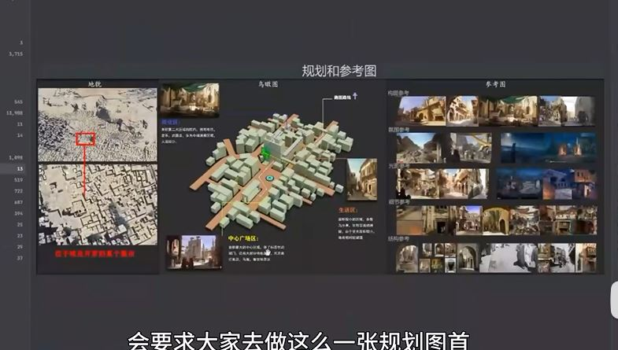
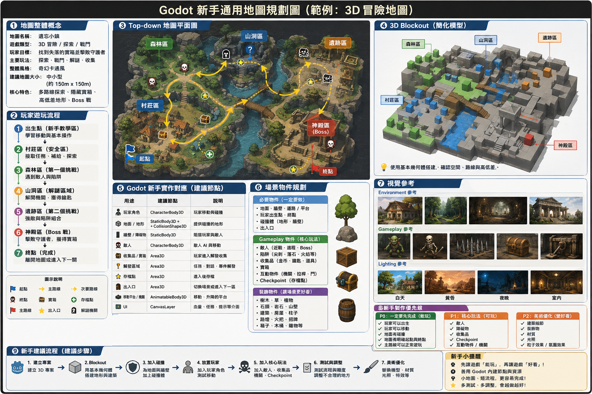
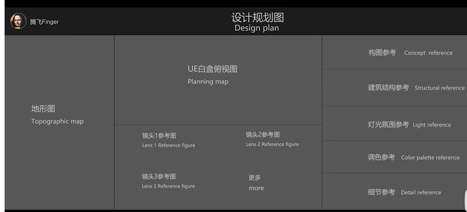
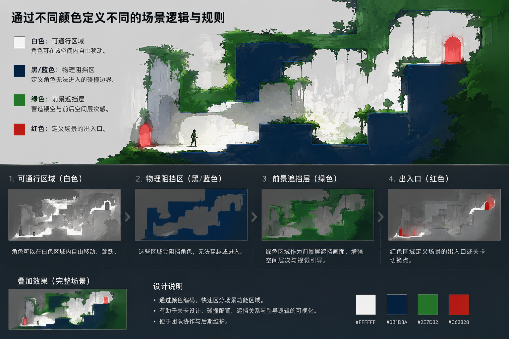
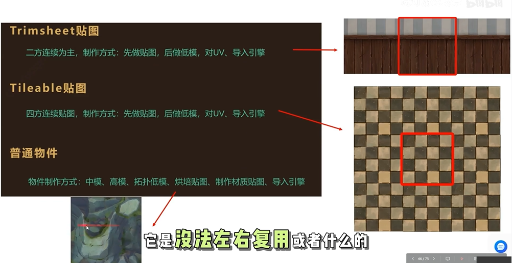

### 美術
如何偷學漫畫【畫風】？
```
第一步：抄（臨摹與觀察）
1. 找到自己喜歡的審美喜好：在不考慮故事的情況下，純粹從畫風上找出自己喜歡的漫畫（不限中、日、美漫）。  
2. 觀察具體畫法（邊抄邊觀察）：每種畫風都有其繪畫特徵與規律，主要可以從形狀、比例、線條去拆解。  

第二步：改（變換與重組）
1. 萃取特徵進行替換與拼湊：學會「改」就是將個人風格與創意融入其中，例如透過拼湊不同的畫風。  
```
彈幕式訊息通知：將微信等訊息以彈幕形式呈現，避免傳統大彈窗遮擋遊戲畫面，保障遊戲過程的沉浸感。  
實況窗狀態顯示：在等待對局或復活時間等空檔時，可將遊戲基礎狀態（如復活倒數、匹配進度）顯示在實況窗上，方便玩家切換出去處理別的事。

建議找美術包
地编参考
洞察力+反思
性轉/擬人化

什麼是繪畫中的生命力？欣賞生命力的本質是在欣賞多樣性。世界上沒有一模一樣的物體，如果不畫出獨有的生命力，就是在忽視個性、抹殺多樣性。
觀察與抽象化動態>大型與小型上的動態強化
繪畫不是要把每一件物體都死記硬背畫一遍，而是「理解了一個東西的規律之後，可以解釋萬物」，做到舉一反三。  
人在學畫畫時往往比較放不開，而畫得好的人普遍膽子都特別大。影片歸納了畫畫膽子大的三點好處：  
敢於嘗試，打破框架:繪畫沒有絕對標準的公式，所有的技法與風格都是透過不斷嘗試摸索出來的。  
敢於修改，不留情面地推倒重來:膽子大的人面對畫錯的地方時，敢於大膽否定自己。   
敢於發問，拒絕無謂的內耗:膽子小的人往往不好意思開口求教，容易在同一個盲點上鑽牛角尖、重複犯錯。
參考 《绝区零》风格细节表现:避免平面化的造型（如平扁的武器/刀具）。必须画出块面的透视厚度与立面转折，体现强烈的体积感与空间穿插（如绳索的前后层次） 
技巧
Godot coding

不要重复造轮子>Assets
[視差省MB+Low poly(Quaternius)+與低解析度貼圖]
tscn | gdscript GD 名Tscn+number+_nodename | assets (audio,png,glb,)
收藏 property (position,rotation,scale,shape) Collision3D常用>Margin以防止穿墙。
用ai寫Tween/Shader
tripoAI+地編
把圖中的結構部件按照3D資產圖一次擺放，所有結構部件不能重複，按照大中小依次排放，8k解析度，頂級攝影照片。電影級布，泛光，風格化PBR，半寫實材質搭配法線貼圖效果為主，輔以手繪質感的磨損細節，絕區零遊戲風格
第一步：核心構想（The Idea）概念完全由開發者自己發想，並與 Claude 進行討論與細化（例如：「這類遊戲通常有哪些機制？是否合適？」），而非盲目交由 AI 決定。   第二步：原型製作（The Prototype）花費約 1 個半月時間，完全不碰視覺美術，僅用 Unity 中的方塊與膠囊人進行灰模（Greybox）測試。  大多數時間都花在遊玩、反覆調整速度、移動、遊戲設計、NPC 與玩家行為邏輯上。   第三步：尋找視覺風格（The Visual Style）將原型截圖上傳給 Claude，請其針對不同風格（如微縮模型 diorama、霓虹車輛等）為 AI 繪圖工具（Nana Banana）編寫提示詞（Prompts）來尋找參考。  結合購買的現成資產、自己在 3ds Max 中製作的模型，以及混搭寫實與卡通化的獨特美學。   第四步：資產與道具（The Assets）選定風格參考後，利用特定關鍵圖像確保所有道具風格保持一致，並由開發者親自動手修改與新增。   第五步：環境與天氣（Environments and Weather）為了避免單一場景過於單調，開發者自行構思了各種天氣與環境主題（如雪景），並透過 Claude 協助編寫環境切換管理器（Switcher）以及雪景 Shader 等程式碼。  地形由手動雕刻，所有道具、燈光與材質皆為手動擺放與調整。   第六步：關卡與除錯（The Level & Coding）程式碼編寫與優化、NPC 行為樹（Behavior Trees）的設計、以及錯誤除錯（Debugging），Claude 提供了大量建議，但最終採用與否、如何修改與整合均由開發者親自把關。  
Juicy 方法
wennie:會讓人不知不覺地被吸引到某個地方
加打擊感:只要互動就加音效|推拉摇移
分段坠落血条/滴體/分段/緩沖血量
UI 与 3D 元素的结合:Ipad/iphone show setting/音效/粒子/字體|偽3d效果>2.5D|3d插畫
建造類遊戲|派對屬性
In加速：先慢后快，拉满期待感。 Out减速：先快后慢，营造爆发式出场的冲击感。
機制:宝箱|门|NPC|子弹|抓钩勾索,傳送門槍,coin〉升級,爬墻,動作設計：技能普攻/強化/大招,無縫第三人稱視角傳送門+robot核心就是key
信息量=完成度|中間插入漫畫演出|武器立繪要立體|連段+斬殺boss 擊破 動畫+處決動畫 攻击音+受击音+攻击vector+粒子特效+相机震动|BoneAttachment3D 节点 绑定到角色的右手骨骼（Right Hand）上，使武器能随角色动作自然移动。弹反和拼刀 (signal)|skilltree+連線 5. 6. 粒子特效|camera delay|遊戲運鏡

### AI生成

1. 場景製作（分三步）
第一步：使用 Image 2.5 先產出一張滿意的場景概念圖，並補上俯視與測試角度。  
第二步：讓 AI 看圖拆解資產，決定哪些交由 Tripo 單獨生成、哪些直接在 Blender 裡搭標客群，並由人工進行確認。  
第三步：將 Tripo 做好的道具與參考圖一起交給 Opus 5.5 照圖復刻。完成後指派一個獨立的審查 Agent 進行多機位盲審，若與參考圖不同則持續修改。  
2. 人物製作（分四步）
第一步：使用 Image 2.5 產出 T Pose 的四視圖。  
第二步：使用 Tripo 的 Smart Match 多視圖生成模型網格，若網格不對則進行局部重生成。  
第三步：透過 Auto-Rig Pro 插件讓 Claude 自動綁定骨骼與蒙皮。  
第四步：從 Mixamo 尋找動作；若沒有現成的動作（例如提水壺），則尋找最接近的動作，再讓 Opus 使用 IK（反向運動學）把手一點點對準到壺把上。  

<hr>

### 地编
```
許多獨立遊戲之所以看起來不好看，是因為缺乏對材質、色彩、燈光、霧氣、氛圍的基礎理解，不知如何將素材組合成一個有凝聚力且獨特的場景。  
```
逆光
模組化
避免模組化重複感的方法：
添加變種：同一類別的模組可製作 2 至 3 種變形（如門窗的不同造型），並透過不同角度、等比旋轉或改變縮放來打破重複感。  
使用 Trim Sheet 貼圖：節省貼圖資源並提升整體一致性。  
豐富的混合材質：結合 Tiling 貼圖、Mask、頂點色與 DECO 等組合，營造出豐富的材質變化。  

初心紀念碑：在項目資料夾中建立「初心.txt」檔案，記錄最初的靈感與核心爽感來源，避免在開發中途迷失方向或加入不必要的複雜系統。  


72小時原型法則：用三天時間製作能跑起來的可玩原型（即使主角是方塊、敵人是圓圈），在原型階段快速驗證想法，可玩的垃圾勝過完美的空想。  


養個備胎項目：當主項目遇到瓶頸想砸键盘時，切換到完全不同類型的副項目，給大腦做SPA，往往能打破死結。  


【【虚幻5】UE5风格化地编场景作品_涩谷站_带跑图】 https://www.bilibili.com/video/BV1vVNnepEDR/?share_source=copy_web&vd_source=d7f849d08eeb1405afe10c2ea0062d8e
【风格化小城市】 https://www.bilibili.com/video/BV1G384zREgS/?share_source=copy_web&vd_source=d7f849d08eeb1405afe10c2ea0062d8e

</img>

</img>

Godot 新手通用地圖規劃 Prompt 請為一名 **Godot 新手開發者**製作一張清晰、容易理解、可以直接拿來製作遊戲的「3D 遊戲地圖規劃圖」。 以 **【遊戲類型／地圖主題】** 為核心，例如：冒險地圖、城市、森林、迷宮、賽車場、平台跳躍關卡、射擊場景、Boss 戰場等。 ## ① 地圖整體概念 先明確定義： * 地圖名稱：**【地圖名稱】** * 遊戲類型：**【遊戲類型】** * 玩家目標：**【玩家需要完成什麼】** * 地圖主要玩法：**【探索／戰鬥／解謎／競速／平台跳躍等】** * 地圖整體風格：**【幻想／現代／科幻／寫實／卡通等】** * 建議地圖大小：以適合 Godot 新手製作的中小型地圖為主 * 避免過度複雜的道路、建築與場景結構 --- ## ② Top-down 地圖平面圖 製作一張清楚的俯視地圖，使用簡單圖形表示： * 玩家起點 * 玩家主要移動路線 * 終點 * 主要區域 * 次要區域 * 道路／通道 * 障礙物 * 敵人區域 * 收集品 * 補給區 * Boss／重要事件區域 * 出入口 使用不同顏色與簡單圖示區分不同功能。 用箭頭表示玩家推薦行進方向。 整體必須一眼看懂，不要使用過於複雜的細節。 --- ## ③ 玩家遊玩流程 明確規劃玩家從開始到結束的流程： **出生點 → 第一個區域 → 教學／探索 → 第一個挑戰 → 中間區域 → 第二個挑戰 → 最終區域 → 終點** 如果是非線性地圖，則標示： **主路線** 以及： **可選探索路線** 讓新手開發者能夠清楚知道玩家會怎麼走。 --- ## ④ 3D Blockout 將俯視地圖轉換成簡單的 3D Blockout。 使用最基本的幾何體： * Cube * Cylinder * Plane * Ramp * Wall * Stairs 不要製作精細模型。 用不同高度表示： * 地面 * 高台 * 建築 * 山坡 * 懸崖 * 樓梯 * 平台 重點是確認： **空間比例、玩家移動距離、道路寬度、高低差與視線。** --- ## ⑤ Godot 新手實作對應 在規劃圖旁邊標示每個區域可以使用的 Godot 基礎節點。 例如： * 地面 → `StaticBody3D + CollisionShape3D` * 牆壁 → `StaticBody3D` * 道具 → `Area3D` * 玩家 → `CharacterBody3D` * 敵人 → `CharacterBody3D` * 觸發區域 → `Area3D` * 出入口 → `Area3D` * 移動平台 → `AnimatableBody3D` * 斜坡 → `MeshInstance3D + CollisionShape3D` * UI → `CanvasLayer` 只使用 Godot 新手容易理解的基本節點。 --- ## ⑥ 場景物件規劃 列出地圖需要製作的主要物件： ### 必要物件 * 地面 * 牆壁 * 道路／平台 * 玩家出生點 * 終點 * 碰撞體 ### Gameplay 物件 * 敵人 * 陷阱 * 收集品 * 寶箱 * 互動物件 * Checkpoint ### 裝飾物件 * 樹木 * 石頭 * 建築 * 路燈 * 箱子 * 招牌 * 植物 把「Gameplay 必要物件」與「純裝飾物件」明確分開。 --- ## ⑦ 視覺參考 提供少量、容易理解的參考圖： ### Environment 建築、地形、道路、植物、岩石等。 ### Gameplay 玩家活動空間、障礙物、敵人位置。 ### Lighting 白天／夜晚／黃昏／室內等。 ### Color Palette 提供 3～5 個主要顏色，確定整張地圖的視覺方向。 不要堆放大量無關參考圖。 --- ## ⑧ 新手製作優先級 在地圖右下角加入： ### P0：一定要先完成 * 玩家可以出生 * 玩家可以移動 * 地面有碰撞 * 地圖有明確起點與終點 * 主路線可以正常遊玩 ### P1：核心玩法 * 敵人 * 障礙物 * 收集品 * Checkpoint * 互動物件 ### P2：美術優化 * 建築細節 * 裝飾物 * 材質 * 光照 * 粒子效果 * 氛圍效果 讓新手知道： **先讓地圖「能玩」，再讓地圖「好看」。** --- ## ⑨ 最終規劃圖版面 使用類似遊戲開發企劃板的資訊整理方式： **左側：** 地圖概念 + 玩家目標 + 遊玩流程 **中央：** 大型 Top-down Map + 玩家路線 + 區域標示 **右上：** 簡化 3D Blockout **右中：** Environment Reference **右下：** Godot Node 對應 + 製作優先級 整體採用： **清晰、簡潔、遊戲開發文件風格、容易閱讀、適合 Godot 新手理解。** 避免過度專業的美術術語、過度複雜的建築細節與不必要的小型資訊。 最終目標是讓一名第一次使用 Godot 3D 的新手，看完規劃圖後可以直接開始： **建立 Scene → 建立 Blockout → 加 Collision → 放置 Player → 建立 Gameplay → 最後進行美術優化。**

</img>
unity插件:Easy Build System
1. 地編:2d原圖>轉3d 刨解+貼紙指引+房子四視圖
2. 場景要找：中世界/熱帶島/紐約/地鐵
3. csg:operation,union,subtraction
4. 通过不同颜色定义不同的场景逻辑与规则 (白,黑,绿,红)
```
白:可通行区域;黑/藍：物理阻挡区;绿：前景遮挡层，营造镂空与前后空间层次感;红：出入口
```
</img>
6. 将原画思维转变为 3D 关卡美术视角，哪怕只是制作一个很小的场景 Demo，也要保证空间结构的合理性和全角度的美观与连贯
10. 構圖-空間-建築-植被-山石-地表-燈光-耐看度
11. 模組化:1圖3變

排布插件 ：github.com/HungryProton/scatter<br>
地形插件 ：Terrain 3D<br>
材质下载插件：	Poly Haven Import/Ambient CG (error) <br>
</img>
material>DiffuseMode,Specular Mode都改成Toon+roughness要拉到1>toon 3渲2,卡通着色（Toon shading）,菲涅尔效应（Fresnel）,抖动輪廓
gpuparticle(process material)>cpuparticle
像素風設定 Texture → Filter 設為 Nearest/Project → Rendering → Pixel Snap

Albedo（基礎色 / 固有色）：物體本身的顏色，決定物體吸收多少光、反射多少光。
Roughness（粗糙度）：決定高光的集中或發散程度。  
Metallic（金屬度）
Normal（法線貼圖）：用以精細控制表面光照反射的微觀方向與凹凸細節。
Fresnel實現「透肉感」:菲涅爾效應：光線入射角不同，反射率會產生變化。[視線的水面幾乎沒有反射能看到水底，而遠處水景反射則非常清晰。] PBR 完美模擬了這種物理規律。  「濕身效果」的實現原理：在原有 PBR 材質貼圖上，疊加一層半透明的雨水材質貼圖。  覆蓋原表面的粗糙度、金屬度和法線等信息，並利用動態遮罩與水痕法線貼圖，讓水滴隨機出現與消失，呈現出水膜的高光與逼真的動態雨滴感。

【迷失 Stray 地编参考】https://www.bilibili.com/video/BV1enK562E17/?share_source=copy_web&vd_source=d7f849d08eeb1405afe10c2ea0062d8e
【Godot学习记录_快速搭建3D室外场景】 https://www.bilibili.com/video/BV1bV6wBXE5o/?share_source=copy_web&vd_source=d7f849d08eeb1405afe10c2ea0062d8e
【游戏地编如何服务射击游戏？】 https://www.bilibili.com/video/BV1frJi6SEcF/?share_source=copy_web&vd_source=d7f849d08eeb1405afe10c2ea0062d8e

人類的視覺特性：天生被亮色吸引，也會因光而聚焦；光影能讓物品的材質更容易被大腦感知，使視覺上更輕鬆。 
色彩搭配（遵循 6:3:1 原則）  
光影營造（運用局部暖光與明暗交織）  
生活巧思（加入有意思的設計與思考）  
灯光：玩家判断空间“正常”与“异常”的第一信息源。大烟雾实体感强、轮廓清晰，适合表现重击/砸落； 小烟雾呈薄纱状、飘忽不定。 


AI地编核心製作步驟與實操細節[AI 的角色：承擔重複勞動]
AI 產出資產階段流程：準備參考圖放入 AI 建模工具的場景拆分模板，將圖拆成獨立模型並逐個生成。局部修正技巧：生成的模型若出現變形或瑕疵（例如人物腿部比例不對），無須整張重來，只需將有問題的小塊單獨摳出重新生成即可。實操細節：關鍵詞不需過於複雜，用大白話描述即可；勾選「石勾上幾何紋理」、「AI 補全」和「PBR」；面數不足時手動調高。避坑提示：AI 目前對植被的生成效果較差，場景中能不用就不用。
白盒階段（搭建結構）順序：先結構，後資產（切忌一上來就堆疊模型）。做法：先用最簡單的幾何體（牆壁、地面等大件）打出白盒，快速定下空間、構圖比例與層次。確認無誤後，再將 AI 生成的資產逐個替換進去。
燈光佈局階段（核心重點）
燈光數量不多但分工明確，主要包含以下層次：
第一主光：決定整個畫面的方向感。
第二天光：使用 HDR 環境光打底，撐起整體環境亮度。
第三天窗補光：在頂部開口處加一盞射燈，強調光衰效果（直射光打到地板後反彈到周圍，邊緣有柔和衰減，營造真實的光效溢出）。
第四背光：場景背面避免死黑，補入帶有偏冷微光的背光。
第五局部補光：針對直射光照不到的牆面、角色、走廊各補一盞，確保明暗關係豐富且不死黑。
體積物與光痕控制：遠景適度加入散射體積物（強度需控制，過強會發白）；所有補光皆須柔和，避免留下明顯的人工光痕跡，光源顏色盡量統一、整體傾向暖色。
後期校色與細節調整
AI 生成的素材通常顏色偏重，需進行後期統一處理：
控制曝光：避免過曝。
飽和度與色調：拉低飽和度避免過豔；若整體偏紅則往冷調回推。
對比度與灰階：對比度太重時適度拉開灰階。
前景細節：例如地面加入一點金屬質感，透過簡單的 PBR 材質調整粗糙度即可。

別着急上色：
早期設計先用黑白灰做介面，僅靠間距、字重和對比度來分層級，用來確保骨架清楚、主次分明。顏色應用來強化重點，而非支撐結構。  
字號並非萬能（善用字重與顏色）：
避免所有文字字重都一樣（例如全用 400），只靠字體大小來分層會導致標題過度膨脹。應透過字重（如標題加粗到 700）與 2-3 種文字顏色來建立層次。  
弱化次要元素以凸顯重點：
當主角跳不出來時，不要盲目為主角加特效，而是將未選中的次要元素調淺、降成常規字重，主角自然成為焦點。  
非必要不用標籤（Label）：
避免每行都加上像資料庫欄位一樣重的「標籤 + 數據」。可以去掉標籤，將核心數據加大加粗放在最上方（如郵件、電話一眼可知）。  
按按鈕的主次分配，不按含義：
避免將刪除（紅）、編輯（藍）、發佈（綠）全部做成實心並排搶戲。一個頁面通常只有一個主操作、一兩個次操作，其餘為輔助；危險操作（如刪除）可退成文字連結，等點擊後再彈出確認框。  
二、 留白、佈局與空間感（第 7 - 12 條）
從过度留白開始再收緊：
平時做法是「擠了再補」，導致元素空間不足。正確做法是先給予遠超所需的留白，再慢慢收緊，這樣放在整個介面中往往剛好。  
不必填滿屏幕（小界面從小尺寸開始）：
桌面時代寬度不一定非要拉滿。如果畫面的內容不需要那麼寬，收窄居中反而更好看；設計小介面時，可以先從 400px 的手機寬度開始畫。  
間距有親疏（組距大於內距）：
標籤上下距離要符合「組與組的間距大於組內元素的間距」原則。標籤應貼近屬於它的輸入框，不需額外加線。  
MD+ 1
縮放不總是等比：
桌面端的標題與正文比例（如 2.5 倍），直接搬到手機端會變得笨重且佔空間。大屏上越大的元素，到小屏縮放的比例要相應調整（例如大標題在手機上只需比正文大 1.7 倍左右）。  
行長與行高聯動：
每行字數建議控制在 45–75 個字符。行越長，行高就要越大（寬的約 1.8 至 2），大標題則反過來，行高收緊到 1.1 至 1.2。  
基線對齊，不盲目居中：
標題旁掛着小字連結時，若直接上下居中，小字會像漂浮在半空。應對齊基線（字母坐着的那條隱形橫線），整行視覺才會立刻穩定。  
MD+ 1
三、 色彩系統與視覺細節（第 13 - 18 條）
顏色比想象的多（建立系統化色板）：
僅靠 5 個色碼無法做好設計。一套成熟的 UI 通常需要：灰色 8–10 檔、品牌主色 5–10 檔、紅黃綠等強調色各 5–10 檔。  
無障碍也可以好看：
彩色小標籤要達到無障礙對比度標準（如 WCAG 要求普通文字至少 4.5:1），採用「淺底深字」的搭配，對比度高且看着柔和。  
別只靠顏色傳遞信息：
區分狀態（如漲跌）不能僅靠紅綠兩色，色盲用戶或在強/弱光下會失效。應同時搭配圖標（如上下箭頭），顏色只能作為強化手段。  
強調色邊框（增加重心）：
一張素淨的白卡片如果缺少重心，可以在卡片頂部加上一條彩色細條（或應用於選中的導航項、提示框側邊），瞬間提升設計感。  
圖上文字先處理背景：
當照片光影複雜、白字壓在亮處容易隱形時，應墊上半透明黑色蒙版、降低圖片對比度、疊加品牌單色或加入文字光暈。  
每樣東西有適用尺寸：
圖標和截圖不能無腦放或隨意縮放。小圖標放大後线条會過粗，應保持原大小並套用淺色圓底；後台截圖若直接縮小會變成螞蟻線，應截取核心局部或繪製簡化示意圖。  
四、 邊框精簡與狀態設計（第 19 - 20 條）
慎用邊框（以留白和陰影替代）：
區分元素時，如果到處都是 1 像素的灰邊，介面會像滿是噪點的 Excel 表。可以拿掉外框和描邊，改用陰影、灰底，或是直接拉大間距（留白本身就是最好的分割線）。  
別忽視空狀態（Empty State）：
新功能上線或沒有數據時，不能只冷冰冰地寫一句「未找到數據」。空狀態是新用戶與功能的第一次接觸，應設計插畫、清晰的引導語以及醒目的添加按鈕。  
